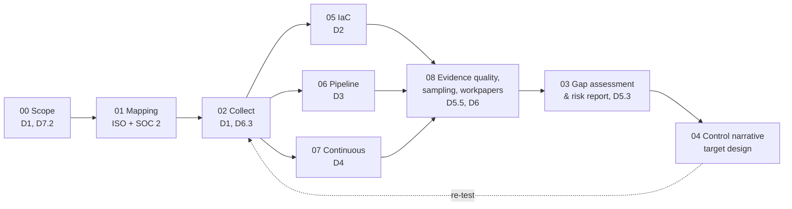

# Alignment: GRC Engineering Club – CGE-AUD (Auditor) → This Portfolio

Every module of the **GRC Engineer Academy, Auditor track (CGE-AUD)** mapped to the artifact in this repository that puts it into practice. Module numbers follow my course notes.

**Coverage:** 27 of 28 modules demonstrated. 7.3 (PCI DSS) is out of scope by design: Tausi doesn't process cards.

## Engagement flow

The repo follows the structured audit process from the course, start to finish, against one company:

| Audit phase | Folder |
|---|---|
| 1. Plan & scope | [00-engagement-scope](00-engagement-scope) |
| 2. Request evidence | [00-engagement-scope/evidence-request-list.md](00-engagement-scope/evidence-request-list.md) |
| 3. Collect | [02-evidence-collection](02-evidence-collection), the `evidence/` folders in 05–07 |
| 4. Judge evidence quality | [08-evidence-evaluation/evidence-quality-assessment.md](08-evidence-evaluation/evidence-quality-assessment.md) |
| 5. Test controls | [05](05-iac-audit), [06](06-pipeline-audit), [07](07-continuous-monitoring), [08 WP-08](08-evidence-evaluation/workpaper-WP-08-A.8.5-mfa.md) |
| 6. Findings & risk report | [03-gap-assessment](03-gap-assessment) |
| 7. Workpapers & sign-off | WP-05, WP-06, WP-07, WP-08, [AI use log](08-evidence-evaluation/ai-use-log.md) |

## Module-by-module

### Domain 1: Cloud and code literacy for auditors

| Module | Course idea | Where it's applied |
|---|---|---|
| 1.1 Why auditors need tech literacy | Controls are code, evidence is JSON, frequency is continuous | The whole repo: no screenshots, every test is a re-runnable script |
| 1.2 Cloud 101 | Accounts, regions, regional vs global services, shared responsibility, carve-outs | [Scope memo §2–5](00-engagement-scope/scope-memo.md); collector v2 tests regional checks in **every** region and finds the eu-west-1 gap (GAP-19) |
| 1.3 Reading JSON & YAML | Read pipeline evidence, IAM policies, YAML workflows | Evidence envelopes ([02](02-evidence-collection)); IAM `PutUserPolicy` with `s3:*` on `*` read in [WP-07](07-continuous-monitoring/workpaper-WP-07-continuous-controls.md); `deploy.yml` read in [WP-06](06-pipeline-audit/workpaper-WP-06-change-management.md) |
| 1.4 Reading HCL and Terraform | Provider → resource → control attributes; follow module `source` | [`client-repo/`](05-iac-audit/client-repo), [WP-05 §5.1](05-iac-audit/workpaper-WP-05-s3-module.md) |
| 1.5 Git and GitHub | PRs as SoD evidence, branch protection, workflow files, `protected_branch` audit log | [06 evidence](06-pipeline-audit/evidence); the three "right asks" in [WP-06 §3](06-pipeline-audit/workpaper-WP-06-change-management.md) |

### Domain 2: Auditing infrastructure as code

| Module | Course idea | Where it's applied |
|---|---|---|
| 2.1 What IaC changes | The population, where evidence lives, the IaC-aware test procedure, the right ask | [WP-05 §2](05-iac-audit/workpaper-WP-05-s3-module.md); request R4 |
| 2.2 Reading a module | 5-step read: README → main.tf → variables.tf → validation → outputs; flag controls exposed as variables | [WP-05 §5.1](05-iac-audit/workpaper-WP-05-s3-module.md); `iac_audit.py control-inputs` finds `enable_access_logging` (GAP-14) |
| 2.3 Sampling from IaC | Module n = 1, all orphans, rationale template | `iac_audit.py orphans` finds 2 orphans (GAP-13); n = 1 rationale in [WP-05 §4](05-iac-audit/workpaper-WP-05-s3-module.md) |
| 2.5 IaC as evidence | State file as inventory, state backend controls, drift, cite file + line + commit + state timestamp | [WP-05 header, §5.3, §7](05-iac-audit/workpaper-WP-05-s3-module.md) |

### Domain 3: Auditing CI/CD pipelines

| Module | Course idea | Where it's applied |
|---|---|---|
| 3.1 Pipeline anatomy | `on` / `jobs` / `steps` / `needs`; who can edit the workflow file | D7–D9 and P6 in `sod_checks.py`; PR #258 (GAP-15); this repo's own [CODEOWNERS](.github/CODEOWNERS) |
| 3.2 SoD in a pipeline world | Branch protection, sampled PRs, bypass events, admin override, author ≠ approver identity test, AI reviewers as a control | P1–P5 in [WP-06 §6.2](06-pipeline-audit/workpaper-WP-06-change-management.md) (bot approval, second account, protection window, override) |
| 3.3 Build logs as evidence | One artifact, many controls; retention vs audit period | T3, T4 in WP-06; GAP-17; [A.8.15 narrative](04-control-narrative/A.8.15-logging.md) step 7 |
| 3.4 Approval gates | Good vs red flags; the scoping question; PR → build log → approval trace | [WP-06 §2 walkthrough](06-pipeline-audit/workpaper-WP-06-change-management.md), trace T1–T4 |

### Domain 4: Cloud-native monitoring & continuous controls

| Module | Course idea | Where it's applied |
|---|---|---|
| 4.1 Automated vs point-in-time | Configuration + execution log + alerts; no gaps; review all alerts | [WP-07 §2–4](07-continuous-monitoring/workpaper-WP-07-continuous-controls.md); `analyze_continuous.py executions` |
| 4.2 Drift detection | Detect → Alert → Ticket → Remediate → Validate; MTTR; the three breakpoints | `analyze_continuous.py drift`: every breakpoint type found (GAP-18) |
| 4.3 Cloud audit logs | The 5 Ws; query by `eventName`, `eventTime`, `userIdentity`; retention; access paths | `analyze_continuous.py events`; `CreateBucket` trace in WP-05; access arrangement in [scope memo §8](00-engagement-scope/scope-memo.md) |

### Domain 5: AI-assisted auditing

| Module | Course idea | Where it's applied |
|---|---|---|
| 5.1 Claude Code 101 | Pull evidence, read Terraform in plain English, draft workpapers | This version was built with Claude Code. See the [AI use log](08-evidence-evaluation/ai-use-log.md) |
| 5.2 Skills and plugins | Skills, plugins (`grc-auditor`), MCP | Tool and plugins recorded in the AI use log |
| 5.3 Drafting a risk report | Ranked, evidence-cited; Condition / Criteria / Cause / Effect; how findings connect; reviewed-and-not-flagged; limitations and requests | [03 §5–9](03-gap-assessment/README.md) |
| 5.4 Multi-framework gap + workpaper | Test once, satisfy many | `soc2_tsc` in [mapping](01-control-mapping/annex-a-control-mapping.csv), every evidence envelope and the gap register |
| 5.5 Guardrails | AI assists, the auditor signs; record prompt, output, human review, tool version; when to reject | [AI use log](08-evidence-evaluation/ai-use-log.md); AI disclosure in every workpaper header |

### Domain 6: Evidence evaluation

| Module | Course idea | Where it's applied |
|---|---|---|
| 6.1 Evidence quality | Relevance, reliability, sufficiency, timeliness; hierarchy; verifiable authenticity; meta-controls; descriptions aren't evidence | [Evidence quality assessment](08-evidence-evaluation/evidence-quality-assessment.md); `collect_evidence.py --verify`; `evidence_tier` field |
| 6.2 Sampling continuous evidence | Temporal, entity, event-type, anomaly; document the rationale | [Sampling rationale](08-evidence-evaluation/sampling-rationale.md) |
| 6.3 AWS audit playbook | Read-only `SecurityAudit` role, script run by or for the client, JSON + readable summary | [02](02-evidence-collection): live mode, `summary.md` + JSON |
| 6.4 Workpaper documentation | Precise population, sample with file/line/commit, period-wide conclusion; the three anti-patterns | [WP-08](08-evidence-evaluation/workpaper-WP-08-A.8.5-mfa.md) and the conclusion section of WP-05/06/07 |

### Domain 7: Framework engagements

| Module | Course idea | Where it's applied |
|---|---|---|
| 7.1 SOC 2 Type II of a cloud-native SaaS | IaC, CI/CD and logs instead of screenshots | Every workpaper carries the SOC 2 crosswalk. Q3 look-back mirrors a Type II period |
| 7.2 ISO 27001 in cloud-native environments | ISMS scope for a cloud environment; Annex A → cloud-native artifacts | [Scope memo §1](00-engagement-scope/scope-memo.md); [mapping](01-control-mapping); clause-level gaps in [03](03-gap-assessment) |
| 7.3 PCI DSS scoping in the cloud | CDE, segmentation evidence | **Not covered.** Tausi doesn't store, process or transmit cardholder data (payments go through a hosted provider). Segmentation evidence would come from the same security-group exports used in NET-01 |

## What changed from v1

| v1 | v2 |
|---|---|
| 4 artifacts: mapping, collector, gap assessment, narrative | 8 artifacts + alignment map. Added 00 scope, 05 IaC, 06 pipeline, 07 continuous, 08 evidence evaluation |
| Collector tests one region | Every in-scope region, SOC 2 crosswalk, `--verify`, commit provenance |
| 12 gaps (1 Critical) | 19 gaps (2 Critical), each traced to a workpaper |
| Point-in-time configuration only | Q3 operating-effectiveness look-back for change management and monitoring |
| Sampling implicit | Written rationale per test |
| Referenced a CI workflow that didn't exist | Real workflow running 4 test suites + collection + verification, with `.github/` protected by CODEOWNERS |
