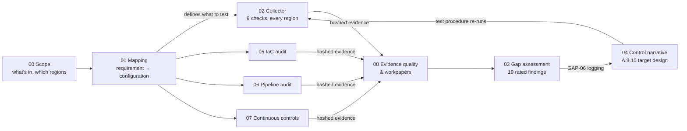

# ISO/IEC 27001:2022 GRC Engineering Portfolio (v2)

**Scope → control mapping → automated evidence → IaC, pipeline and continuous-control audits → evidence evaluation → risk report → control narrative, built end to end against one (fictional) company.**

<p>
  <picture></picture>
  <picture></picture>
  <picture></picture>
  <picture></picture>
  <picture></picture>
</p>

## Why this repo exists

Most GRC work still runs on screenshots and spreadsheets. I wanted to show the alternative: controls defined against real configuration, evidence generated by code, and audit deliverables that trace every finding back to a hashed, re-runnable piece of evidence.

Version 2 is aligned with the **GRC Engineering Club's Certified GRC Engineer – Auditor (CGE-AUD)** course. It audits a cloud-native company the way the course teaches: read the Terraform instead of asking for screenshots, test segregation of duties at the merge button, check that continuous controls actually ran all period, and write workpapers a reviewer can reproduce. [**ALIGNMENT.md**](ALIGNMENT.md) maps every course module to the artifact that demonstrates it.

Everything is built around **Tausi Telehealth Ltd**, a fictional Nairobi-based telehealth startup that handles patient data on AWS and GitHub and wants ISO 27001 certification. Using one company means each artifact feeds the next, the same way it would on the job.

## The artifacts

| # | Artifact | CGE-AUD | What it shows |
|---|---|---|---|
| 00 | [**Engagement scope**](00-engagement-scope) | D1, D7.2 | ISMS scope, accounts and regions, regional vs global services, shared-responsibility carve-outs, the evidence request list |
| 01 | [**Control mapping**](01-control-mapping) | D5.4, D7.2 | 18 Annex A controls mapped to AWS and GitHub configuration, evidence and tests, with a SOC 2 crosswalk, scope and sampling strategy |
| 02 | [**Evidence collector**](02-evidence-collection) | D1, D6.3 | Python collector: 9 checks in every in-scope region, timestamped, SHA-256-hashed JSON evidence, `--verify` for tamper detection. Runs without an AWS account |
| 03 | [**Gap assessment & risk report**](03-gap-assessment) | D5.3 | 19 gaps rated by likelihood × impact, Condition/Criteria/Cause/Effect for criticals, how the findings connect, what passed, 90-day roadmap |
| 04 | [**Control narrative**](04-control-narrative) | D6.4 | A.8.15 Logging written for an auditor, with tests of design and operating effectiveness |
| 05 | [**IaC audit**](05-iac-audit) | D2 | 5-step read of a Terraform compliance module, state-vs-cloud orphan finder, n = 1 sampling rationale |
| 06 | [**Pipeline audit**](06-pipeline-audit) | D3 | SoD and change management tested on 100% of PRs and deploys: bypass events, identity test, PR → build log → approval trace |
| 07 | [**Continuous monitoring**](07-continuous-monitoring) | D4 | Config execution gaps, the Detect → Alert → Ticket → Remediate chain, MTTR, the 5 Ws from CloudTrail |
| 08 | [**Evidence evaluation**](08-evidence-evaluation) | D5.5, D6 | Evidence quality per artifact, sampling rationale per test, a modern workpaper (A.8.5), AI use log |

## How the pieces connect



The loop is the point: the mapping says what good looks like, the scripts measure it, the evidence evaluation decides what the results can prove, the assessment prioritises what's missing, and the narrative defines the fix and how it will be tested. Then the scripts prove the fix.

## Try it in 30 seconds

```bash
git clone <this-repo>
cd <this-repo>

# Configuration checks against a mock AWS account (two regions)
cd 02-evidence-collection && python collect_evidence.py --mock sample_data/mock_aws_environment.json --as-of 2026-10-23 && cd ..

# Orphan resources outside Terraform
cd 05-iac-audit && python iac_audit.py orphans --state evidence/prod-s3.tfstate.json evidence/platform.tfstate.json \
  --inventory evidence/s3-inventory.json --exceptions evidence/known-exceptions.json \
  --cloudtrail evidence/cloudtrail-createbucket-q3.json; cd ..

# Segregation of duties across every PR and deploy in Q3
cd 06-pipeline-audit && python sod_checks.py --evidence evidence; cd ..

# Did monitoring run every day, and was every alert handled?
cd 07-continuous-monitoring && python analyze_continuous.py drift evidence/drift-events-q3.csv \
  --status evidence/config-recorder-status.json --as-of 2026-10-23
```

Standard library only, no AWS account needed. The audit scripts exit 1 when they find exceptions, which is the expected result here. Tests: `python -m pytest -q` in each of 02, 05, 06 and 07 (34 tests).

## What the audit found

- **A HIGH SQL injection reached production** after a contractor's pipeline change made the security scan non-blocking. Neither PR broke a branch-protection rule (GAP-15).
- **2 of 5 console users have no MFA.** Config flagged it every day of Q3, and nobody opened a ticket (GAP-01).
- **2 patient-data buckets were made by hand**, outside the Terraform module, by those same two users (GAP-13).
- **Monitoring was switched off for 6 days** with a 215-day-old access key, and nothing alerted (GAP-18).
- **The ISMS core is missing:** no risk method, no SoA, no internal audit (certification blockers).

## Skills demonstrated

- **Framework knowledge:** ISO/IEC 27001:2022 clauses 4–10 and Annex A, with a SOC 2 TSC crosswalk
- **Cloud-native audit:** reading Terraform and state, orphan detection, pipeline SoD, build-log evidence, continuous-control testing, CloudTrail 5 Ws
- **Audit thinking:** test of design vs operating effectiveness, population vs sample, written sampling rationale, evidence hierarchy and meta-controls
- **Risk analysis:** likelihood × impact, security risk vs certification readiness, showing how findings compound
- **Engineering:** Python, boto3, unit testing, GitHub Actions, evidence as code
- **Responsible AI use:** AI-assisted drafting with a logged prompt, output, human review and tool version

## Notes

- Tausi Telehealth, its people and its environment are fictional. Account IDs, access keys and IP addresses use AWS and IETF documentation examples.
- ISO control descriptions are my own paraphrases, not the standard's text. The SOC 2 crosswalk is my own judgement.
- Parts of v2 were drafted with Claude Code. See the [AI use log](08-evidence-evaluation/ai-use-log.md).
- Built by **Louisz Rigensky W.** · [LinkedIn](https://www.linkedin.com/in/louisz-rigensky-w-3b7700213) · CGE-AUD
